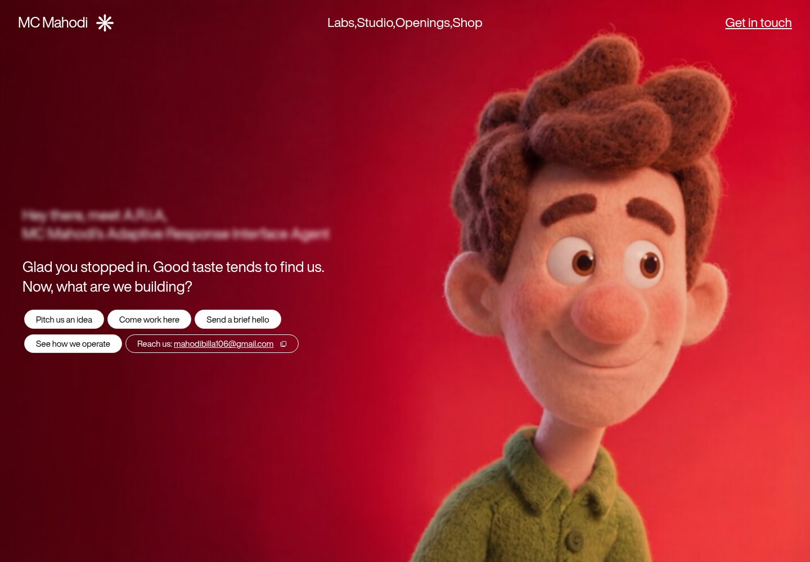
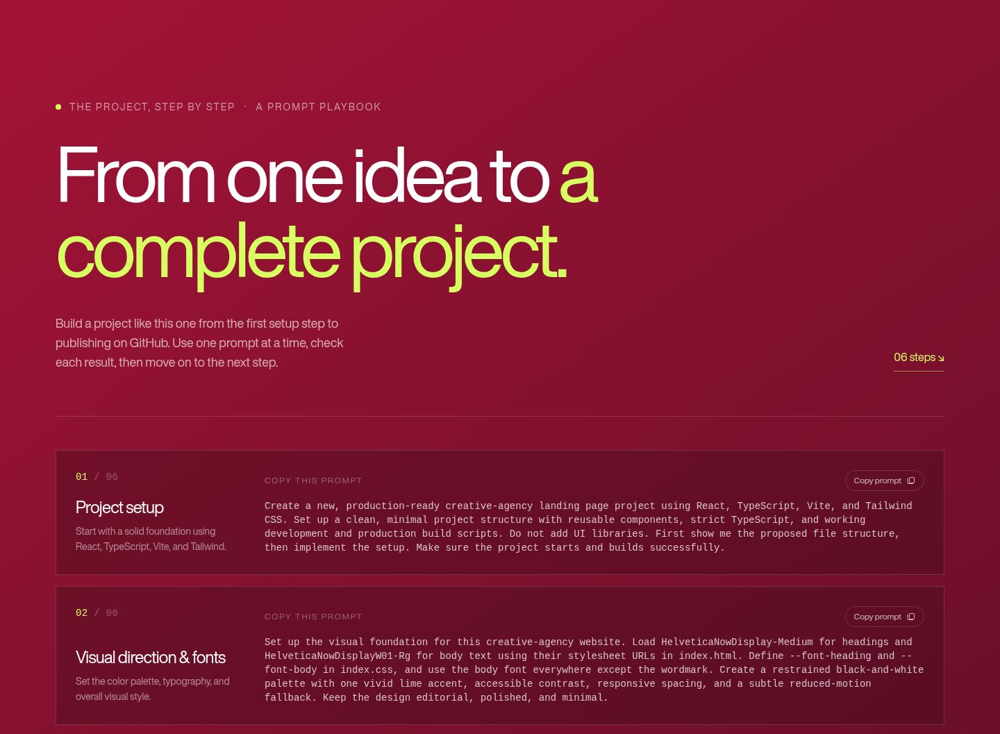

<div align="center">

# MC Mahodi Creative Studio

**An interactive creative-agency landing page — and a step-by-step prompt playbook for building it.**

[](https://react.dev/)
[](https://www.typescriptlang.org/)
[](https://vite.dev/)
[](https://tailwindcss.com/)
[](https://github.com/mb-mahodi/mc-mahodi-creative-studio)

<br />

<a href="docs/images/hero-preview.jpg">
  
</a>

<br />

*Move your cursor horizontally across the hero to scrub the background video.*

</div>

## About

MC Mahodi Creative Studio is a responsive, motion-led landing page built around a full-screen video hero. Below the introduction, a six-part prompt guide walks through how to create a similar project—from initial setup to preparing it for GitHub.

The project combines a distinctive visual direction with small, useful interactions, while keeping the implementation focused on React, TypeScript, Vite, and Tailwind CSS.

## Highlights

- **Mouse-controlled video:** Scrub the full-screen background forward or backward with horizontal mouse movement. The video is muted and does not autoplay.
- **Responsive navigation:** Centered desktop links and an animated mobile menu with accessible labels and keyboard behavior.
- **Animated introduction:** A blurred greeting, a character-by-character typewriter message, and an independently animated set of calls to action.
- **Copy-to-clipboard actions:** Copy the contact email or any of the six project prompts.
- **Prompt playbook:** A practical, ordered guide covering setup, visual direction, the video hero, navigation, interactions, testing, documentation, and GitHub.
- **Responsive and motion-aware:** Layouts adapt to smaller screens and respect reduced-motion preferences.
- **Fast production build:** Vite bundles a static site into `dist/`.

## Prompt guide preview

<p align="center">
  <a href="docs/images/prompt-guide-preview.jpg">
    
  </a>
</p>

## Contents

- [Getting started](#getting-started)
- [Available commands](#available-commands)
- [How the prompt playbook works](#how-the-prompt-playbook-works)
- [Customize the project](#customize-the-project)
- [Project structure](#project-structure)
- [Build and deploy](#build-and-deploy)
- [Media and fonts](#media-and-fonts)
- [License](#license)

## Getting started

### Requirements

- [Node.js](https://nodejs.org/) 20.19+ or 22.12+
- npm
- An internet connection for the hosted hero video and web fonts

### Install and run locally

```bash
git clone https://github.com/mb-mahodi/mc-mahodi-creative-studio.git
cd mc-mahodi-creative-studio
npm ci
npm run dev
```

Open the local URL printed by Vite in your terminal.

## Available commands

| Command | Description |
| --- | --- |
| `npm run dev` | Start the local development server. |
| `npm run build` | Type-check the project and create a production build in `dist/`. |
| `npm run preview` | Preview the production build locally. Run `npm run build` first. |

## How the prompt playbook works

The guide at the bottom of the page contains six copyable prompts. For the best results, give them to your coding assistant **one at a time**. Review and run the project after each step before continuing.

1. **Project setup** — Create the React, TypeScript, Vite, and Tailwind foundation.
2. **Visual direction and fonts** — Establish the typography, palette, and design system.
3. **Video hero** — Add the full-screen video and mouse-controlled scrubbing.
4. **Navigation and menu** — Build responsive desktop and mobile navigation.
5. **Content and interactions** — Add the typewriter, contact actions, and prompt guide.
6. **Testing and publishing** — Check the project, write its documentation, and prepare it for GitHub.

Each prompt has its own **Copy prompt** button. The clipboard API works on `localhost` and on secure HTTPS deployments.

## Customize the project

| What to change | Where |
| --- | --- |
| Agency name, contact email, navigation, hero copy, and prompt guide | `src/App.tsx` |
| Background video source | `VIDEO_URL` in `src/App.tsx` |
| Video loading preview image | `public/images/hero-poster.jpg` |
| Global typography and CSS | `src/index.css` |
| Page title, description, and font stylesheets | `index.html` |
| Tailwind content paths and theme | `tailwind.config.js` |

The hero uses an externally hosted video. If you replace it with a video that is not publicly accessible, host it somewhere your visitors can reach and update `VIDEO_URL`.

## Project structure

```text
.
├── docs/
│   └── images/              # README screenshots
├── public/
│   └── images/
│       └── hero-poster.jpg  # Local preview while the video loads
├── src/
│   ├── App.tsx              # Page sections and interactions
│   ├── index.css            # Global styles and design tokens
│   └── main.tsx             # React entry point
├── index.html
├── package.json
└── vite.config.ts
```

## Build and deploy

Create and verify a production build:

```bash
npm ci
npm run build
npm run preview
```

The generated static site is in `dist/`. To deploy, connect this repository to a static hosting provider such as Vercel, Netlify, or Cloudflare Pages and configure:

| Setting | Value |
| --- | --- |
| Build command | `npm run build` |
| Output directory | `dist` |

The GitHub repository stores the source code; a hosting provider is needed to publish the live website.

## Media and fonts

The hero video and Helvetica Now font stylesheets are loaded from external URLs, so those assets require a network connection. A compressed local poster image is included to provide a visual fallback while the video loads.

## License

No license file is currently included. Until a license is added, the repository is public to view, but reuse and redistribution are not granted by default.
